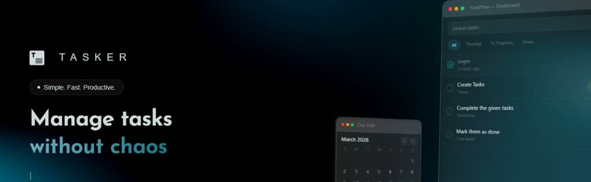

## 📝 Intro

**Tasker** helps you organize your work, track focus sessions, and see your progress. Create tasks, set time goals, and use the dashboard to see what’s pending, in progress, or complete.

👉 **Live** [taskerflow.duckdns.org](https://taskerflow.duckdns.org/)

---

## 🧰 Tech Stack

- **Backend** — Python and Flask
- **Frontend** — React, TypeScript, Vite, and Tailwind CSS
- **Database** — SQLite using Python’s `sqlite3` module
- **Authentication** — JWT access and refresh tokens, bcrypt, and emailed recovery codes
- **Deployment** — Hostinger VPS with Docker, Nginx, and HTTPS

[Local setup, API endpoints, and deployment instructions](docs/setup.md)

---

## 🚀 Features (What Users Can Do)

- ✍️ **Sign up and sign in** to a personal dashboard.
- 🗂️ **Create, edit, and organize tasks** with titles, descriptions, and statuses.
- 🔎 **Search and filter tasks** by title or status.
- ⏱️ **Track focus sessions** and see whether you beat an optional time goal.
- 📊 **Review activity stats** and unlock activity rings after completing three tasks.
- 🔒 **Manage your password** from the dashboard or reset it with a verification code sent to your registered email.

---

## ⚙️ Process (How It Works)

Tasker serves the React app and Flask API from the same domain. Flask stores each user’s tasks and timer sessions in SQLite and uses Gmail to deliver password recovery codes on the live site.

### System Architecture Diagram

```text
PHASE 1: SIGN IN
┌────────────────────────────────────────────────┐
│ React sends sign-in details to the Flask API   │
│ Flask checks the password and returns tokens   │
└───────────────────────┬────────────────────────┘
                        ▼
PHASE 2: CREATE AND ORGANIZE TASKS
┌────────────────────────────────────────────────┐
│ The dashboard sends authenticated requests     │
│ Flask reads and writes the user’s SQLite data  │
└───────────────────────┬────────────────────────┘
                        ▼
PHASE 3: TRACK A FOCUS SESSION
┌────────────────────────────────────────────────┐
│ Start and stop the timer for a selected task   │
│ Save the duration and compare it to the goal   │
└───────────────────────┬────────────────────────┘
                        ▼
PHASE 4: REVIEW PROGRESS
┌────────────────────────────────────────────────┐
│ Show task counts and timer statistics          │
│ Unlock activity rings after three completions  │
└────────────────────────────────────────────────┘
```

---

## 📚 What I Learned

- Connecting a React and TypeScript frontend to a Flask API
- Designing a SQLite schema for users, tasks, and timer sessions
- Handling JWT refresh and one-time password recovery codes
- Adapting the same visual style to desktop and mobile layouts
- Deploying a Dockerized app behind Nginx with HTTPS and persistent storage

---

## 🎥 Demo Video

[Watch the Tasker walkthrough](docs/tasker-demo.mp4) to see task creation, filtering, the focus timer, and activity stats.
